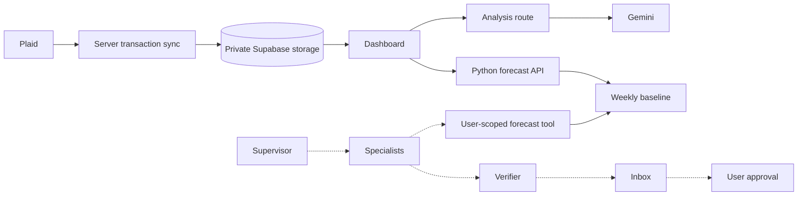

# MintSage

Personal-finance prototype built with Next.js, Supabase, Plaid, and Gemini.
The web app includes authentication, bank linking, a transaction dashboard,
and spending analysis. The dashboard calls the Python forecast service in this repository.

See the [implementation roadmap](docs/roadmap.md) for the original engineering
upgrade plan, completed cleanup, and planned personal-finance features.

## Repository layout

```text
app/                         Next.js web app and API routes
  src/app/                   Pages, layouts, and API handlers
  src/components/dashboard/  Active dashboard components
  src/components/ui/         Shared shadcn/ui components
  src/lib/                   Supabase, Plaid, and transaction helpers
  src/types/                 Shared transaction type
forecasting/                 Forecast API, baselines, and synthetic evaluation
database/schema/             Original Supabase table and policy definitions
database/migrations/         SQL changes applied after the existing schema
docs/                        Implementation roadmap and project documentation
experiments/forecasting/      Offline Python experiments, models, and sample data
```

The web app is independent of the Python experiments. See the
[experiment notes](experiments/forecasting/README.md) for their entry points
and limitations.

## Forecast service

From the repository root, install `forecasting/requirements.txt` into a Python
virtual environment. Set the same private `AGENT_SERVICE_SECRET` in the Python
process and the Next.js server, then start the service:

```sh
python -m uvicorn forecasting.service:create_app --factory --host 127.0.0.1 --port 8000
```

Next.js defaults to `http://127.0.0.1:8000/forecast`. Set `FORECAST_URL` to
an HTTPS endpoint when deploying the services on separate hosts. The authenticated
dashboard sends 60 consecutive UTC dates, one observed net spending amount per
day, and USD. Confirmed zero-spending days and negative refund totals are valid.
Missing days block prediction. The service returns the next 30 dates and estimates
by repeating the last seven days. The dashboard checks the dates and amounts and
reports a service failure or eight-second timeout. The agent tool accepts a
session-bound history loader when the agent graph is assembled.

The [synthetic evaluation](forecasting/README.md) includes reproduction commands,
model selection and held-out results. Historical experiments remain under
`experiments/forecasting/`.

## Dashboard data sharing

When the dashboard has sufficient USD history, it sends the last 60 dates and
daily spending totals to the configured forecast service. The 30-day spending
forecast is experimental and its accuracy has yet to be validated.

After the forecast succeeds, the dashboard assistant automatically asks Gemini
for an initial analysis. Each chat submission also calls Gemini. The prompt
contains the question, income, spending, net and average daily net, volatility
and trend, up to five category names with sums, counts and maxima, and the
forecast mean and trend. Users can include additional information in their
question. The dashboard assistant is the only current Gemini caller.
It can explain findings and suggest actions. It cannot move money or change
external accounts.

## Agent dependencies

Install the agent packages in a separate Python environment with
`python -m pip install -r agent_service/requirements.txt`. Configure
`LANGGRAPH_STRICT_MSGPACK=true` in the agent process when enabling checkpoints.
The selected backend is PostgreSQL. See the maintainers’ [checkpoint deserialization advisory](https://github.com/langchain-ai/langgraph/security/advisories/GHSA-g48c-2wqr-h844)
and [SQLite advisory](https://github.com/langchain-ai/langgraph/security/advisories/GHSA-9rwj-6rc7-p77c).

## Web development

```sh
cd app
npm ci
npm run dev
```

Copy `app/.env.example` to `app/.env.local` and configure the providers.
Rename any older `NEXT_PUBLIC_PLAID_*`, `NEXT_PUBLIC_GEMINI_API_KEY`, and
`NEXT_PUBLIC_FORECAST_URL` variables to their server-only names in the example.
Rotate previously exposed secrets when deploying the change.
Next.js registers the session proxy from `app/src/proxy.ts`.

Apply database migrations in filename order before deploying the app.
The transaction sync migration adds private per-connection storage and an event
table for agent consumers. The dashboard requests 365 days for new items,
syncs on load, and shows USD insights only after historical sync and evidence
of 60 days of coverage. Institution updates older than 48 hours suppress insights.
Posted refunds offset category spending. Transfers and debt repayments stay
in the ledger and are excluded from spending. Ambiguous rows carry a review flag.

Agent endpoints must be wrapped with `agent_service.auth.ServiceAuthentication`
using the same secret as Next.js. Handlers use the authenticated ASGI state
field `user_id`. The agent workflow itself is scheduled for later steps.

### Plaid token storage

Set `SUPABASE_SECRET_KEY` in the Next.js server environment to a Supabase secret
key for the project identified by `NEXT_PUBLIC_SUPABASE_URI`. Keep this key out
of browser configuration and source control.

Apply the [token storage migration](database/migrations/202611220001_secure_plaid_tokens.sql)
to the database that already contains `public.plaid_tokens`. For a fresh
database, load the definitions in `database/schema/` first. Roll out the app
and migration together because the migration revokes the old app's access.
Existing token rows are retained.

In staging, link a Plaid Sandbox account and open the dashboard. Confirm
that the exchange returns only `{ "connected": true }` and that both Plaid
routes return 401 without a session. Confirm that anonymous and signed-in
browser clients cannot read or write token rows, including their own.

Local checks, from `app/`:

```sh
npx tsc --noEmit
npm test
npm run lint
npm run build
```

The unused standalone `/chat` route was removed; dashboard chat remains.
Unused deployment ZIPs were removed from the working tree. Previous versions
remain in Git history, which has not been rewritten. Next.js scaffolding and
the components in `app/src/components/ui/` include generated code.

## Architecture and delivery status

Application code computes financial figures. The agent design assigns workflow
selection to a supervisor, numeric checking to a verifier, and approval of
internal changes to the user. Solid arrows show implemented paths. Dotted arrows
show planned orchestration.



The dashboard uses the forecast API directly. The Python forecast tool is
available for future agent runs. Read the [model card](docs/model_card.md),
[agent card](docs/agent_card.md), [foundation verification record](docs/foundation-verification.md)
and [current step status](update.md).

### Environment and deployment

| Variables | Consumer and purpose |
| --- | --- |
| `NEXT_PUBLIC_SUPABASE_URI`, `NEXT_PUBLIC_SUPABASE_ANON_KEY` | Browser and Next.js clients use the same Supabase project and public key. |
| `NEXT_PUBLIC_DEV_SUPABASE_REDIRECT_URL` | Optional full signup callback URL. Allowlist the app's `/auth/confirm` URL in Supabase Auth. |
| `SUPABASE_SECRET_KEY` | Server-side token and transaction storage. |
| `PLAID_CLIENT_ID`, `PLAID_SECRET`, `PLAID_ENV` | Server-side Plaid API client. Use sandbox for staging. |
| `PLAID_PRODUCTS`, `PLAID_REDIRECT_URI` | Comma-separated Link products and optional registered OAuth redirect. |
| `GEMINI_API_KEY` | Server-side dashboard analysis. The optional live CI job maps its GitHub secret to the Google client environment. |
| `FORECAST_URL`, `AGENT_SERVICE_SECRET` | Forecast endpoint and shared credential. Set the credential on both services. |
| `AGENT_SERVICE_URL` | Reserved HTTPS endpoint for future agent workflows. |

1. Provision Supabase and configure email confirmation and allowed redirect URLs.
   Use the same origin for signup and its callback so the PKCE verifier is available.
2. For a fresh project, run `database/schema/users.sql` and
   `database/schema/plaid_tokens.sql` as the database administrator. For an
   existing project, confirm which schema changes have already been applied.
3. Take a database backup. In a maintenance window apply *pending*
   `database/migrations/*.sql` in filename order, one transaction per file.
   Record each successful filename in deployment history. The first migration
   revokes legacy token access, the second initializes sync state and events,
   and the third creates profiles during signup, backfills missing profiles and
   enables profile RLS. Pair the third migration with the updated signup page.
4. Deploy the forecast service using the factory command above behind HTTPS.
   Configure Next.js with its URL and shared credential, then build and start
   the app with `npm ci && npm run build && npm start` from `app/`.
5. Complete the staging checks in the verification record before promoting.
   If a migration fails, inspect the failed transaction before retrying.
   Coordinate database and app restoration if reverting across schema versions.

### Automated checks

Use Python 3.14 and Node 26 to reproduce the local checks. From the repository
root, activate a virtual environment and install `requirements-dev.txt`. Run
`ruff check forecasting agent_service`, `mypy forecasting agent_service`, and
`python -m pytest -q forecasting/tests agent_service/tests`. From `app/`, run
`npm ci`, `npm run lint`, `npx tsc --noEmit`, and `npm test`.
Install the local hooks with `pre-commit install` in the activated environment.
GitHub Actions runs these checks and a placeholder production build on pushes
and pull requests. Dispatch **Live agent tool evaluation** in Actions to exercise
Gemini on synthetic histories with a configured repository secret.
